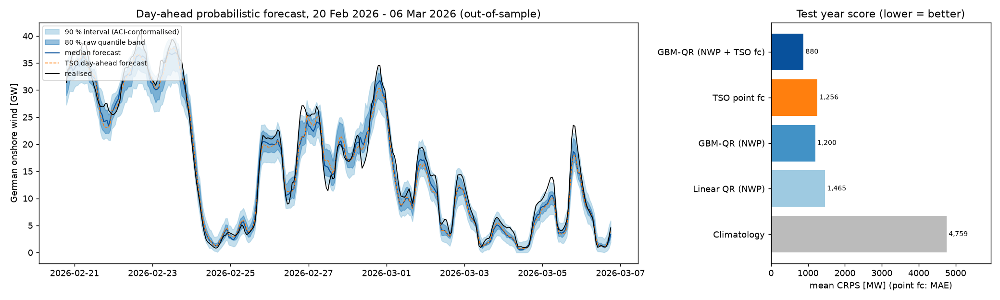
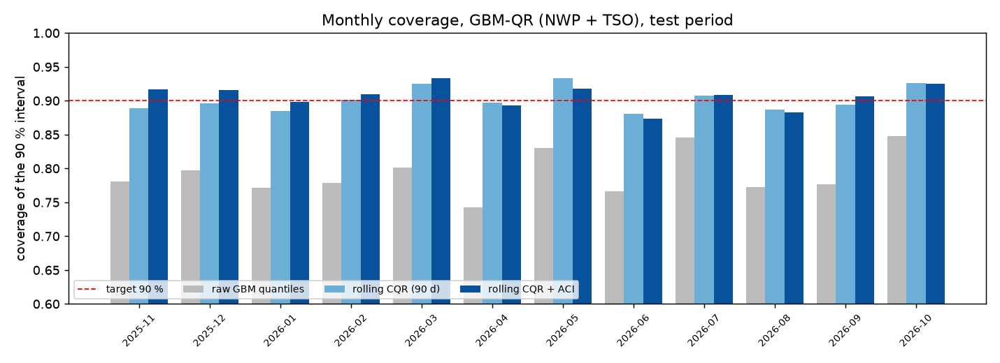
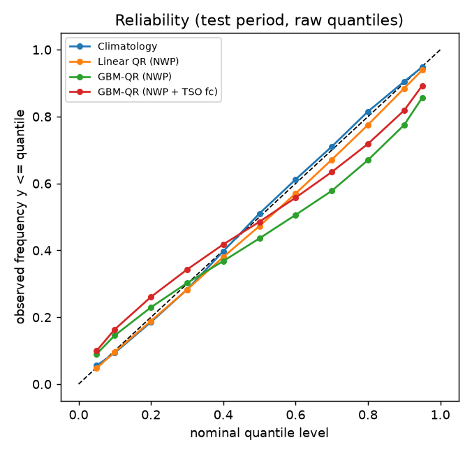
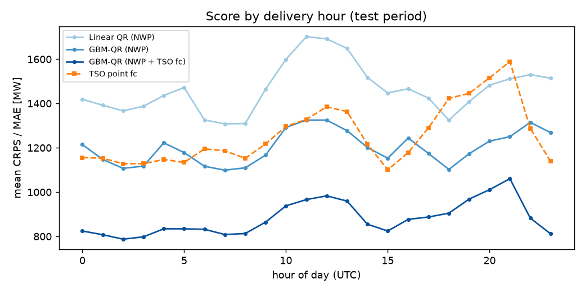

# Probabilistic day-ahead forecasting of German onshore wind power with conformal calibration

Quantile forecasts of hourly German onshore wind generation for the next day, built from **ex-ante weather forecasts**
(DWD ICON-EU, the run issued the day before) at 20 grid points, with **conformalized quantile regression (CQR)** and
**adaptive conformal inference (ACI)** to make the prediction intervals hit their nominal coverage. Everything is
evaluated in a 12-month rolling-origin backtest (Nov 2025 – Oct 2026, 8,732 hours) on real public data.



## Key results (test period 2025-11-01 → 2026-10-31, mean installed onshore capacity 69.6 GW)

| Model | CRPS [MW] | CRPS skill vs climatology | MAE of median [MW] | raw 90 % interval coverage | 90 % coverage after rolling CQR | mean 90 % width after CQR [MW] |
|---|---|---|---|---|---|---|
| Climatology (monthly quantiles) | 4,759 | 0 % | 7,065 | 89.2 % | 89.9 % | 29,615 |
| Linear quantile regression (NWP) | 1,465 | 69.2 % | 2,125 | 89.1 % | 90.2 % | 8,619 |
| GBM quantile regression (NWP) | 1,200 | 74.8 % | 1,684 | 76.6 % | 89.9 % | 6,790 |
| **GBM-QR (NWP + TSO day-ahead forecast)** | **880** | **81.5 %** | 1,265 | 79.3 % | **90.2 %** | **5,044** |
| TSO day-ahead point forecast (CRPS = MAE) | 1,256 | 73.6 % | 1,256 | – | – | – |

* **A calibrated distribution beats the official point forecast in CRPS by 30 %** (880 vs 1,256 MW; Diebold–Mariano on
  daily CRPS, HAC, stat 16.9, p < 1e-6). The gain comes from the *distribution*, not the centre: the median of that model has
  practically the same MAE as the TSO forecast (1,265 vs 1,256 MW). Put differently, the TSO number is a very good point
  forecast and this project wraps a calibrated uncertainty band around it.
- Using only the ICON-EU forecasts at 20 points (no TSO input), the GBM reaches 1,200 MW CRPS, statistically
  indistinguishable from the TSO point forecast's MAE (DM p = 0.20) and well ahead of linear QR (DM stat 9.3).
- **Raw GBM quantiles are overconfident**: the nominal 90 % band covers only 79.3 % (80 %: 65.5 %). A rolling 90-day CQR
  (scores known by D-2) brings it to **90.2 % (80 %: 80.6 %)** at a mean width of 5.0 GW, and the Winkler interval score
  improves from 7,342 to 6,845 MW. Monthly coverage after CQR stays within 88.1–93.3 % (fig. 2).
- **ACI adds little here**: with daily step γ = 0.02 overall 90 % coverage is 90.7 % at +2 % width and the worst month is
  slightly lower (87.4 % vs 88.1 %). A 90-day rolling calibration window already tracks the drift in this data; ACI's
  guarantee matters more when errors shift abruptly (see `results/aci_gamma_sensitivity.csv`, γ from 0 to 0.05).



| Reliability of the raw quantiles | Score by delivery hour |
|---|---|
|  |  |

## Problem
Day-ahead traders, BESS operators and system operators need not only *how much* wind there will be tomorrow but *how
uncertain* that is: reserve sizing, imbalance risk and battery bidding all depend on the tails. Point forecasts say nothing
about the tails, and quantile models trained by pinball loss are typically miscalibrated out of sample. The question here
is how good a probabilistic day-ahead forecast of German onshore wind can be built from public data, and whether
conformal methods make its intervals trustworthy.

## Method
1. **Target**: hourly realised onshore wind generation divided by installed onshore capacity (monthly, 61.5 → 71.6 GW over
   the sample), i.e. a capacity factor; this removes the capacity growth trend. Scores are reported back in MW.
2. **Ex-ante inputs**: ICON-EU 100 m and 10 m wind speed and 2 m temperature from the **previous day's model run**
   (Open-Meteo Previous Runs API, `*_previous_day1`; lead time about 24 h) at 20 points across the main onshore regions.
   Features: a generic turbine power curve applied per site, regional (north/south) and national means, spatial spread,
   the forecast trajectory at ±1 h/±3 h, shear (100 m/10 m), temperature, hour and season. Optionally the TSOs' published
   day-ahead onshore forecast (Energy-Charts) as one more input. No realised generation enters the features (tested).
3. **Models**: monthly-quantile climatology; linear quantile regression (HiGHS LP, last 8,760 training hours);
   gradient-boosted quantile regression (scikit-learn `HistGradientBoostingRegressor`, pinball loss, one model per
   quantile, 11 levels 0.05–0.95, quantile crossing removed by sorting).
4. **Rolling-origin backtest**: refit at the start of every month from 2025-07 on all data up to D-2 (what is known at a
   D-1 noon gate closure), forecast every hour of the month. Jul–Oct 2025 are warm-up for the conformal step; the test year
   is Nov 2025 – Oct 2026.
5. **Conformal calibration** of the 80 % and 90 % intervals on the out-of-sample forecasts: CQR (Romano et al. 2019) with
   scores from the last 90 days whose outcomes are known (≤ D-2), and ACI (Gibbs & Candès 2021) updating the working α once
   per day with the miss rate of day D-2.
6. **Scores**: CRPS approximated as 2 × mean pinball loss over the 11 levels (for a point forecast the CRPS is its absolute
   error), MAE/RMSE of the median, coverage, width and Winkler score; Diebold–Mariano tests on daily mean CRPS (HAC, h = 2);
   reliability (observed frequency below each quantile).

## How to run
```bash
python -m venv .venv && source .venv/bin/activate
pip install -r requirements.txt
python -m pytest -q                 # 14 tests, ~5 s
python scripts/run_backtest.py      # ~15-30 min on 8 cores (16 monthly refits x 11 quantiles x 3 models)
python scripts/make_figures.py
# re-download the data (Energy-Charts + Open-Meteo, ~5 min, rate-limited):
python scripts/fetch_data.py        # or: scripts/run_all.sh --fetch
```
`data/de_wind_hourly.csv.gz` (1.2 MB) is the cached input; `results/` holds every forecast, metric and test table
(`metrics.csv`, `intervals.csv`, `dm_tests.csv`, `coverage90_by_month.csv`, `reliability.csv`, `aci_gamma_sensitivity.csv`,
`summary.json`). A CI example is in [`docs/ci_example.yml`](docs/ci_example.yml).

```
src/dwpf/   data.py (download/cache), features.py, models.py (QR, GBM-QR, rolling backtest), conformal.py (CQR, ACI), metrics.py
scripts/    fetch_data.py, run_backtest.py, make_figures.py, run_all.sh
tests/      unit tests: scores, conformal finite-sample quantile, CQR coverage, ACI under a variance shift, ex-ante checks
```

## Data and licences
* **Energy-Charts.info** (Fraunhofer ISE), API `api.energy-charts.info`: realised public net onshore wind generation,
  TSO day-ahead onshore wind forecast, monthly installed onshore capacity for Germany. Licence **CC BY 4.0**
  (underlying sources include the German TSOs and Bundesnetzagentur | SMARD.de). 15-minute values are averaged to hourly UTC.
* **Open-Meteo** Previous Runs API (`previous-runs-api.open-meteo.com`), model ICON-EU by **Deutscher Wetterdienst (DWD)**,
  licence **CC BY 4.0**. Sample 2024-03-01 → 2026-10-31 (previous-day runs are archived from early 2024).

## Limitations
* The weather inputs are 20 grid points of one NWP model, not the TSOs' full multi-model, turbine-level setup.
* The "previous_day1" series gives every hour the forecast issued about 24 h before it, a fixed lead, not the exact
  12–36 h horizon of a D-1 noon gate closure: for evening hours of day D that run is somewhat *newer* than one a trader
  would have at the gate (slightly optimistic), for night and morning hours it is older (slightly pessimistic).
  The scores are therefore a close approximation of a true D-1 noon forecast, not an exact replay.
* Curtailment (redispatch, negative-price shutdowns) is in the realised target but not modelled explicitly; it is one
  reason the upper tail on windy, low-load hours is hard.
* The TSO forecast used as a feature is the value published by Energy-Charts; its exact publication time relative to a
  noon gate closure was not verified hour by hour.
* Conformal guarantees assume exchangeability; hourly wind errors are autocorrelated and seasonal, so coverage is
  empirical (reported per month), not guaranteed. Only the 80 % and 90 % central intervals are conformalised; the full
  quantile set is evaluated raw.
* One test year, one country, one technology. No trading or imbalance-cost evaluation is claimed; this is a forecasting study.
* Hyperparameters are fixed a priori (not tuned on the test year); ACI γ is reported as a sensitivity, with γ = 0.02 chosen in advance.

## References
Romano, Patterson, Candès (2019) *Conformalized Quantile Regression*, NeurIPS. · Gibbs, Candès (2021) *Adaptive Conformal
Inference Under Distribution Shift*, NeurIPS. · Gneiting, Raftery (2007) *Strictly proper scoring rules*, JASA. ·
Diebold, Mariano (1995) *Comparing predictive accuracy*, JBES.

## License
MIT © 2026 Syed Muhammad Taha Nasir. Data remain under their own CC BY 4.0 licences (attribution above).
